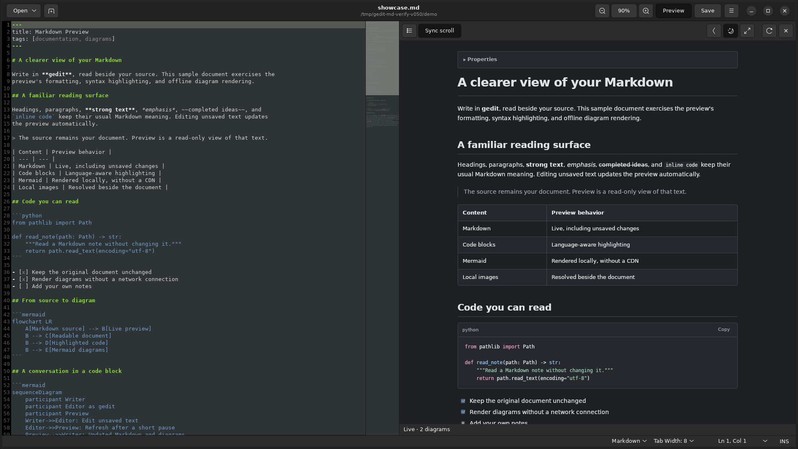
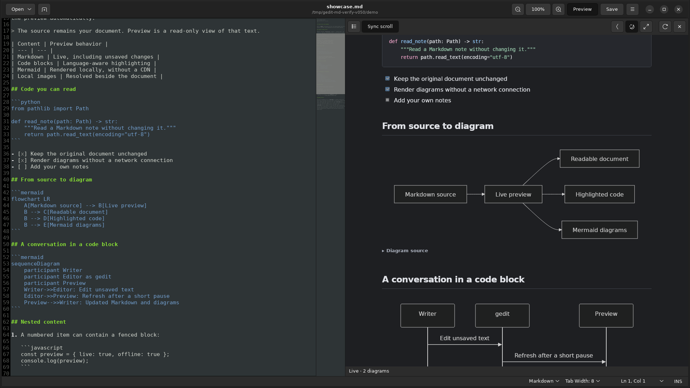
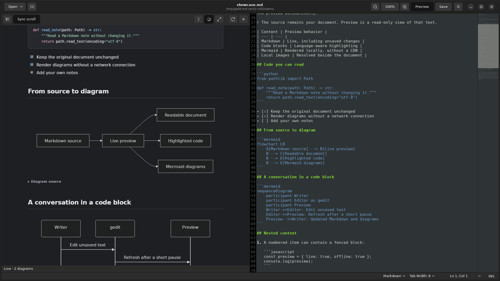
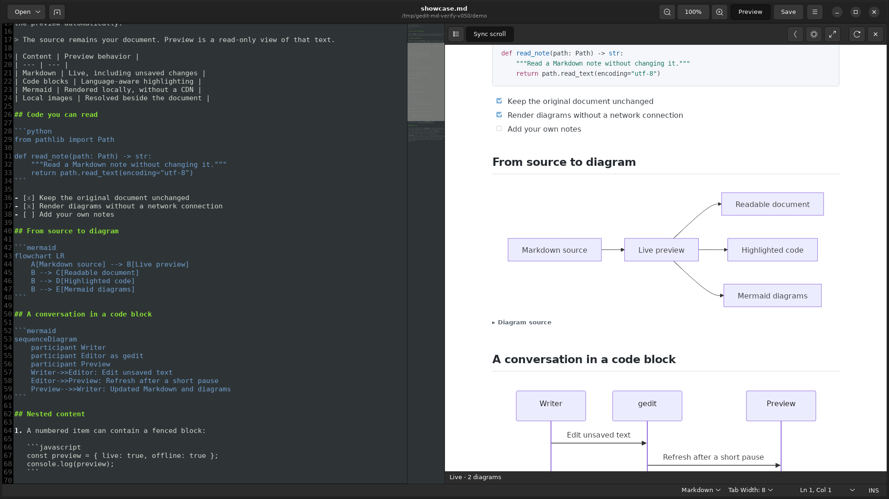
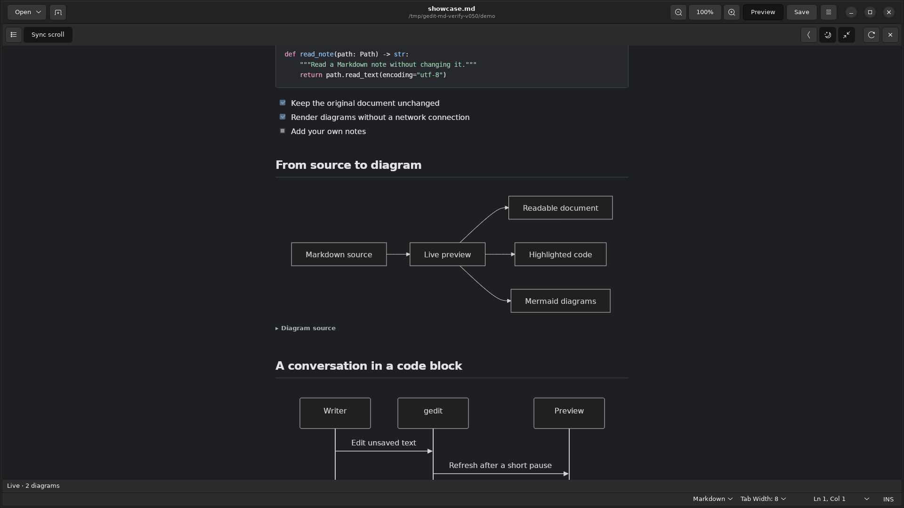
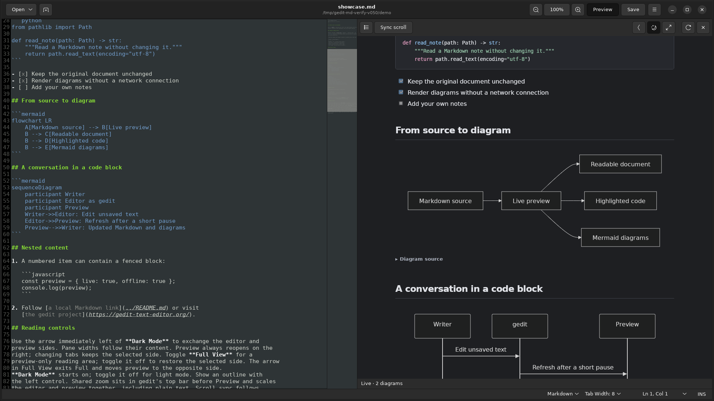

# Markdown Preview for gedit

**By [Cloudberry](https://github.com/cloudberryyum)**

A live Markdown reading pane inside gedit, with familiar VS Code / Obsidian
styling, highlighted code, and locally rendered Mermaid diagrams.

This is a gedit plugin, not a separate editor. Normal editing remains in gedit.
WebKit is loaded only when preview is opened. The installed plugin needs no
Node.js runtime, local server, network connection, or account.

## Screenshots

| Markdown preview with shared header zoom | Offline Mermaid diagrams |
| --- | --- |
|  |  |

| Preview moved to the left | Light mode |
| --- | --- |
|  |  |

| Full view | Sync scroll (off) |
| --- | --- |
|  |  |

All screenshots are real captures of the plugin running in gedit 41 on
Ubuntu 22.04, using the bundled [examples/showcase.md](examples/showcase.md).

## Compatibility

| Environment | Status |
| --- | --- |
| Ubuntu 22.04, gedit 41, GTK 3, WebKit2 4.0 | Tested by the maintainer on real hardware |
| Ubuntu 24.04, gedit 46, GTK 3, WebKit2 4.1 | Tested by the maintainer |
| Ubuntu 26.04, other distributions, other gedit versions | Not tested |
| gedit 48.2 and later | Unsupported: these versions removed Python plugin support |

The plugin accepts WebKit2 4.1 or 4.0 introspection bindings, so it follows the
distribution's WebKit packages. Older engine versions than the ones listed above
are not covered by the same test evidence.

## Install

First diagnose the current computer:

```sh
/usr/bin/python3 manage.py doctor
```

If dependencies are missing, use the matching command:

```sh
# Ubuntu 22.04
sudo apt install gedit python3-gi gir1.2-webkit2-4.0

# Ubuntu 24.04
sudo apt install gedit python3-gi gir1.2-webkit2-4.1
```

Install the plugin for the current user:

```sh
/usr/bin/python3 manage.py install
```

Save your work and restart gedit yourself. In **Preferences → Plugins**, enable
**Markdown Preview**. Open a Markdown document and click **Preview** immediately
to the left of **Save** in gedit's header bar. Its tooltip is **Markdown Preview**.
You can also press **Ctrl+Alt+M** or choose **Markdown Preview** in gedit's menu.

Installation copies only `mdpreview.plugin` and `mdpreview/` into
`${XDG_DATA_HOME:-~/.local/share}/gedit/plugins/`. It does not enable plugins,
change file associations, or close editor windows. Run the same command to
update an existing installation created by this installer.

## Use

- **Preview header button:** toggle preview for the active Markdown file. It
  follows tab changes and Save As. Saved `.md`, `.markdown`, `.mdown`, and `.mkd`
  names are recognized case-insensitively; an untitled buffer uses its Markdown
  syntax mode. The button stays hidden for other saved file types.
- **Shared header zoom:** zoom out, percentage/reset, and zoom in sit immediately
  left of Preview (or Save when Preview is hidden). They remain visible for plain
  text files and when preview is closed. One window-wide percentage scales all
  editor tabs and an open preview together, from 60–200%. Click the percentage
  to restore 100%: the configured editor font size and normal preview scale.
  New tabs and reopened previews inherit the current percentage.
- **Move preview left/right button:** the arrow immediately left of Dark Mode
  points toward the preview's destination. Click to exchange the preview and
  editor sides; their widths follow the content, subject to native minimum sizes.
  Each preview opening starts on the right. Switching tabs keeps the current side.
  In Full View, the arrow exits Full and moves preview to the opposite side.
- **Full View icon toggle:** off uses the selected left or right split;
  drag the divider to resize. On hides the editor and uses the complete editing
  area for preview inside the same window. Toggle off, or close preview, to
  restore the editor on its previous side. Every preview reopening starts with
  Full View off. The icon changes between expand and restore. Other gedit
  panels retain their original layout.
- **Dark Mode icon toggle:** on by default. On uses dark mode and shows a moon;
  off uses light mode and shows a sun. Preview follows this toggle independently
  of the desktop theme. Both icon toggles have tooltips and accessible names.
- **Outline button:** show heading navigation. Narrow panes use inline contents.
- **Sync scroll:** synchronize relative scroll positions in both directions while
  enabled. Turn it off when you want the editor and the preview to scroll
  independently; the positions stay wherever each pane was last left.
- **Refresh:** render immediately after the usual short editing debounce.
- **Close / Ctrl+Alt+M:** release the pane and restore the editor layout.
- **Copy:** copy a fenced code block using the native clipboard.

Preview controls occupy one row. Outline and scroll sync start at the left
edge. The right group is Move preview left/right, Dark Mode, Full View, a
separator, Refresh, and Close. The arrow is an ordinary button, not a toggle.
The preview toolbar has no title or dropdowns; the top-bar Preview button beside
Save remains. The native controls establish a minimum pane width; the split
respects that width instead of clipping the controls.

Editor zoom changes only per-view styling, not gedit's saved font preferences or
document contents. Changes to the configured editor font are respected at the
current percentage. Closing preview keeps editor zoom; disabling the plugin
removes its header controls and restores native editor font sizing.

Preview includes unsaved changes and follows the active editor tab. Controls are
remembered while the window's plugin instance remains active, except placement
and Full View reset to the right split whenever preview opens. No choices are
saved across gedit restarts. A new document with the same basename may retain the
current reading position. Scroll synchronization is proportional, so large
diagrams can make the source and preview positions differ.

Rich preview adds WebKit memory and CPU costs while it is open. Closing the pane
destroys its view; loaded engine libraries can remain mapped in the gedit process.

Try [examples/showcase.md](examples/showcase.md). The renderer handles common
Markdown and GitHub-style tables, task lists, strikethrough, nested fenced code,
and Mermaid fences. Top-of-document YAML frontmatter appears as collapsed
**Properties**; it is displayed as text, not executed or parsed as configuration.

Mermaid diagrams retain their source in a disclosure beneath the image. A bad
diagram shows its parse error and source; other diagrams can still render.
Generated diagrams are sanitized SVG images, with interactive Mermaid callbacks
disabled. This preview does not provide Obsidian plugins, vault management,
wikilinks, or mathematical typesetting.

Local images and Markdown links resolve relative to the saved file's directory.
An untitled document uses the home directory. Remote images are replaced with a
placeholder; network requests are blocked by the preview's content policy.
Clicked HTTP/HTTPS/mailto links open through the desktop. Clicked local Markdown
or text links open in gedit; other local navigation is ignored. Raw HTML is
sanitized, and code blocks are displayed rather than executed.

Documents above 4,000,000 UTF-8 bytes pause preview with a visible explanation.
Close preview to continue normal editing. Standard code languages bundled by
Highlight.js are colored; unknown languages remain readable plain code.

## Uninstall

Disable **Markdown Preview** in gedit, then run:

```sh
/usr/bin/python3 manage.py uninstall
```

Restart gedit yourself. Only this plugin's recognized files are removed; other
plugins and gedit settings are preserved.

## Development and verification

The shipping JavaScript bundle is checked into Git. Its top-level versions are
pinned in `manage.py`; transitive dependencies are resolved at rebuild time.
Review and commit both the bundle and license notices after an intentional
dependency update. Building requires Node.js and npm; installed use does not.

```sh
python3 manage.py build-assets
python3 -m unittest discover -s tests -p 'test_*.py' -v
node --check mdpreview/assets/preview.js
```

The plugin was verified on real gedit 41 and 46 runtimes during development,
including live rendering of Markdown and Mermaid content and the
install/update/uninstall flow.

The GTK integration validates gedit's notebook hierarchy before adding a
plugin-owned split. If an unexpected layout is encountered, it falls back to
the public bottom-panel API, where side switching and Full View are disabled.
The targeted 41/46 panel APIs were checked against their upstream source. A
future gedit migration requires explicit compatibility work rather than
silently assuming the Python plugin will continue to load.

## License

Plugin code is GPL-3.0-or-later; see [LICENSE](LICENSE). Bundled libraries retain
their own licenses in
[THIRD_PARTY_LICENSES.txt](mdpreview/assets/THIRD_PARTY_LICENSES.txt).
