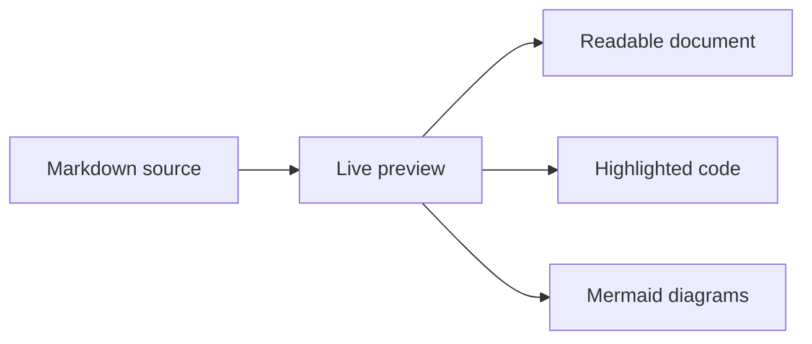
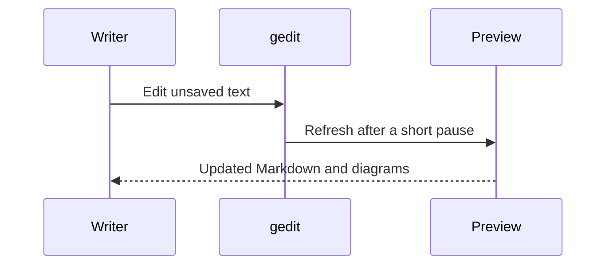

# A clearer view of your Markdown

Write in **gedit**, read beside your source. This sample document exercises the
preview's formatting, syntax highlighting, and offline diagram rendering.

## A familiar reading surface

Headings, paragraphs, **strong text**, *emphasis*, ~~completed ideas~~, and
`inline code` keep their usual Markdown meaning. Editing unsaved text updates
the preview automatically.

> The source remains your document. Preview is a read-only view of that text.

| Content | Preview behavior |
| --- | --- |
| Markdown | Live, including unsaved changes |
| Code blocks | Language-aware highlighting |
| Mermaid | Rendered locally, without a CDN |
| Local images | Resolved beside the document |

## Code you can read

```python
from pathlib import Path

def read_note(path: Path) -> str:
    """Read a Markdown note without changing it."""
    return path.read_text(encoding="utf-8")
```

- [x] Keep the original document unchanged
- [x] Render diagrams without a network connection
- [ ] Add your own notes

## From source to diagram



## A conversation in a code block



## Nested content

1. A numbered item can contain a fenced block:

   ```javascript
   const preview = { live: true, offline: true };
   console.log(preview);
   ```

2. Follow [a local Markdown link](../README.md) or visit
   [the gedit project](https://gedit-text-editor.org/).

## Reading controls

Toggle **Full View** to switch between the Right split and a preview-only reading
area. **Dark Mode** starts on; toggle it off for light mode. Show an outline with
the left control. Shared zoom sits in gedit's top bar before Preview and scales
the editor and preview together, including plain text. Scroll sync follows
relative document position; diagrams and long code blocks can make the two
layouts differ.
